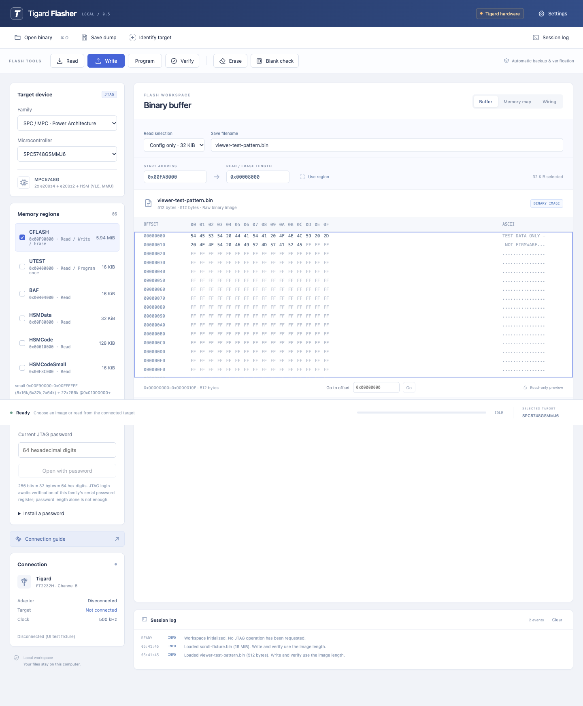

# Tigard Flasher

An experimental SPC/MPC JTAG and SPI flasher with a local browser UI, a Python
CLI, and automated tests with isolated device models. Uses Tigard's FT2232H channel B through pyftdi/libusb.
No account or subscription is needed. The application runs locally; GitHub hosts
the source and release downloads, not a web service that accesses USB.

**Hardware validation is limited to one MPC5748G board: configuration reads and
one configuration-block write with a fresh matching readback.** Other profiles
have offline tests only. This is not a claim of complete SKADI compatibility.
See the [feature audit](docs/FEATURE_AUDIT.md) and [validation record](docs/VALIDATION.md).



Screenshot uses generated test bytes; no firmware or connected target is shown.

## Features

- Read, patch write, program, verify, erase, and blank check for supported flash regions.
- OTP read, program once, verify, and blank check; SHADOW writes preserve valid configuration.
- Family-specific password lengths, SPC560 JTAG authentication, and password installation.
  C55 JTAG authentication and HSM programming remain unavailable; see [security operations](docs/SECURITY_OPERATIONS.md).
- MPC5748G **Config only** default: 32 KiB at `0x00FA8000`. Full-array and custom ranges are selectable.
- Continuous virtualized hex/ASCII viewer for raw binaries up to 16 MiB, offset navigation,
  named saves, SHA-256, drag-and-drop, and cancellable reads.
- Interactive Tigard/14-pin/10-pin/SPI wiring guides, USB presence, and target identification.
- Reviewed write plans, original-block backups with checksums, preserved bytes outside
  a patch, and automatic verification.

| Profile | Main and data flash | Additional regions |
| --- | --- | --- |
| `mpc5748g` / `spc5748g` | 6080 KiB CFLASH; 32 KiB config default | 16 KiB UTEST OTP; BAF and separate HSM ranges read-only |
| `spc560b54` / `mpc5605b` | 768 KiB CFLASH, 64 KiB DFLASH | 16 KiB SHADOW, 8 KiB CFLASH_OTP, 8 KiB DFLASH_OTP |
| `spc560b60` / `mpc5606b` | 1024 KiB CFLASH, 64 KiB DFLASH | Same SHADOW and OTP regions as B54 |
| `spc560b64` / `mpc5607b` | 1536 KiB CFLASH, 64 KiB DFLASH | Same SHADOW and OTP regions as B54 |
| `spc58nh92`, `spc58eh92` | 10 MiB CFLASH, 256 KiB DFLASH | 16 KiB UTEST OTP; BAF and HSM read-only |
| SPI `w25q128jv` | 16 MiB; JEDEC `EF4018` | SPI security registers are not supported |

Only one MPC5748 configuration-block write has hardware evidence. New profiles,
OTP, SHADOW, passwords, and SPC58 programming have offline tests only. Profiles
are explicit: an IDCODE does not establish the exact part or its geometry.
“Full flash” selects the main array; additional regions must be selected separately.
Access still depends on the target's protection and lifecycle state.

## Install and run

Use Python 3.10 or newer. Python 3.13 is the locally tested version.
From a clone or extracted source release:

```sh
python3 -m venv .venv
.venv/bin/python -m pip install -e .
.venv/bin/python launch.py
```

On Windows use `py -3 -m venv .venv`, then `.venv\Scripts\python -m pip install -e .`
and `.venv\Scripts\python launch.py`. The included `.command` and `.cmd` launchers
use that virtual environment after installation. Launchers start in live hardware mode.
No native signed application or Windows installer is supplied.

The UI opens at `http://127.0.0.1:8765` and checks for Tigard on USB. No JTAG
operation starts until requested. There is no simulation mode, demo generator,
or fallback when hardware is missing. Node.js is needed only for UI development tests.
Internet is needed for initial dependency installation; the installed app works offline.

Hardware also requires libusb and host USB permissions. On macOS install
`brew install libusb`. Follow the [pyftdi installation guide](https://eblot.github.io/pyftdi/installation.html)
for Linux permissions and Windows driver setup. USB hardware has only been tested on macOS.

For a target using **Tigard TRST → RESET and SRST → JCOMP**:

```sh
.venv/bin/python launch.py --reset-pin trst --freq 100000
```

The default `--reset-pin srst` instead maps SRST to RESET and TRST to JCOMP on
the 14-pin profiles. Match [the wiring guide](docs/WIRING.md) before connecting.
Choose a particular adapter with `--url ftdi://ftdi:2232h:SERIAL/2`. No developer
adapter is hard-coded. USB presence does not mean the target is responding;
use **Identify** to read its IDCODE, then select the actual chip profile.

Memory operations reset and halt the MCU. The application does not resume it
automatically, including after a read. A successful flash verification does not
prove that edited firmware will boot. Existing dumps and backup directories are
not overwritten. A canceled read is not exported as a complete dump.

Local data stays in `.spc5tool-ui/`, excluded from Git. Use `--workspace PATH`
for separate sessions and `--port PORT` if the port is occupied. Run one server
per workspace and adapter. Stop with Ctrl+C; an active operation is allowed to
finish. The server accepts loopback clients only; it is not a hosted multiuser service.

## CLI

```sh
python3 -m spc5tool info mpc5748g
python3 -m spc5tool plan mpc5748g --address 0xFA8000 --length 0x8000
python3 -m spc5tool idcode --freq 100000
python3 -m spc5tool read mpc5748g config.bin --address 0xFA8000 --length 0x8000 --reset-pin trst
python3 -m spc5tool spi info w25q128jv
```

Use raw `.bin` images, not PCP, HEX, S-records, executables, or simulator archives.
`write`, `program`, and `erase` initially print a plan. Execution needs
`--execute --backup NEW_DIRECTORY`; live MCU modification also needs
`--expect-idcode` matching the target. `write` backs up affected blocks, preserves
unmodified bytes, erases changed blocks, programs, and verifies. `program` is only
for already-erased flash; alignment is 8 bytes on SPC560/MPC5748 and 16 bytes on
SPC58H. `erase` requires whole blocks and cannot erase OTP. SHADOW erase restores
its security/boot configuration tail before returning; only its user area is left blank.

For OTP, select its region and use **Program once** after loading the binary.
The tool checks the input range, saves the original block, requires erased input
units, programs, and verifies. **Blank check** means every requested byte reads FF;
it cannot prove an ECC unit has never been programmed by another tool. Never
reuse a programmed OTP unit. Backups cannot undo an OTP write.

Password lengths are **16 hex digits / 64 bits** for the SPC560B profiles and
**64 hex digits / 256 bits / 32 bytes** for MPC5748G and SPC58H. CLI commands use
`--password-file` and `install-password --new-password-file`, avoiding secrets in
command arguments. Password installation preserves protection settings; it does
not enable censorship. See [security operations](docs/SECURITY_OPERATIONS.md) for
capabilities, input order, source references, and examples.

The shipped application supports live hardware only. `info` and `plan` inspect
geometry without USB. Automated tests inject device models from `tests/` and
never select a runtime simulation mode:

```sh
python3 -m unittest discover -s tests -v
node tests/test_wiring.cjs
```

For browser tests, builds, and GitHub release steps see [CONTRIBUTING.md](CONTRIBUTING.md)
and [docs/RELEASING.md](docs/RELEASING.md).

## License and attribution

Original code and connector diagrams: [MIT](LICENSE). Tigard board rendering:
Franklin Harding, [CC BY-SA 4.0](THIRD_PARTY_NOTICES.md). Runtime dependencies are
installed separately. This independent project includes no proprietary SKADI/P&E
binaries, programming loaders, or customer firmware.
