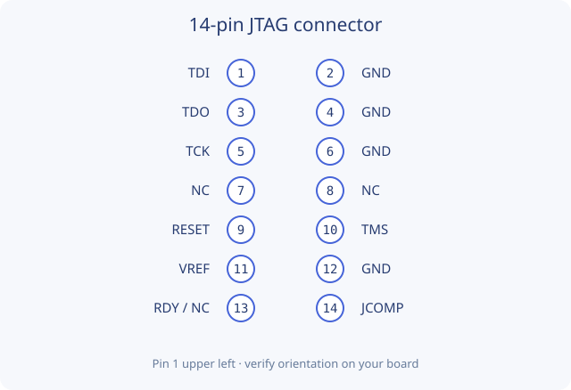
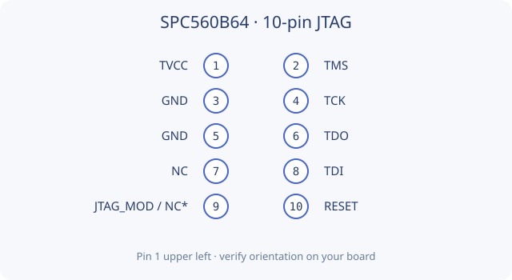

# Wiring

Tigard must be in JTAG/SPI mode. Channel B is `.../2`; channel A is UART.
Connect a common ground and the target debug I/O voltage reference (VTGT).
Select the voltage appropriate to the board's debug pins. The application cannot
measure VTGT or infer board power wiring. Check the printed pin labels against
the [Tigard hardware reference](https://github.com/tigard-tools/tigard).

The UI's Wiring tab highlights both ends of each connection and follows the
session's `--reset-pin` option. Connector pictures are reference layouts, not
universal MCU package pinouts. Pin 1 is upper left and pin 2 upper right in these
drawings; viewing the mating side can mirror the connector.

## MPC5748G and SPC58NH92 — 14-pin reference

| Tigard JTAG pin | Target pin | Signal |
| --- | --- | --- |
| 4 | 1 | TDI |
| 5 | 3 | TDO |
| 3 | 5 | TCK |
| 6 | 10 | TMS |
| 1 | 11 | VTGT / target debug reference |
| 2 | 2, 4, 6 or 12 | GND |
| 7 TRST, with `--reset-pin trst` | 9 | RESET, active low |
| 8 SRST, with `--reset-pin trst` | 14 | JCOMP, held high |

With the default `--reset-pin srst`, swap only the last two Tigard leads: pin 8
goes to target RESET, pin 7 to JCOMP. **JCOMP is separate from reset.** Unused
target pins in this reference are 7, 8, and 13. The SPC58NH92 mapping follows the
same connector reference, but has not been bench-tested with this tool.

## SPC560B64 — 10-pin reference

Target 1 = VTGT, 2 = TMS, 3/5 = GND, 4 = TCK, 6 = TDO, 7 = NC,
8 = TDI, 9 = JTAG_MOD/NC, 10 = RESET. Target pin 9 is not assigned to JCOMP
and is not driven by this guide. Connect the selected Tigard reset lead to pin 10.
No SPC560B64 hardware validation is claimed.

## SPI W25Q128JV

Use Tigard's SPI header, not its JTAG header. Follow the interactive eight-pin
package diagram: CS→1, CIPO→2, WP→3, GND→4, COPI→5, SCK→6, HOLD→7, VCC→8.
The supported profile is for the 3 V part. The tool does not clear block
protection, alter OTP/security registers, or take ownership from another active
SPI master. SPI hardware operation remains unvalidated.
